# From MIDI to three translucent layers

**Development journal · Generative Drawing mid-term · 7 November 2026**

This record follows the saved code and images by version label. The discussion about materials is recorded separately from the software experiments. V0 starts with a different movement, *Contrapunctus VII*. The later work uses *Contrapunctus VIII* from Bach’s *The Art of Fugue*, BWV 1080.

**Through-line.** I wanted to see whether I could follow one melodic line on its own and then see where it met the others. The project moved from getting readable data out of MIDI, through several ways of turning that data into texture, to giving each voice a sheet that shares the same visual clock.

Saved exports and screenshots are identified below. A **re-render** was generated for this journal from the archived code and MIDI, drawing one frame without the interactive window. This journal is an AI-assisted working record for checking against my own notes before preparing assessed writing.

## 01 · Getting music into Python · V0 and the MIDI checks

The first useful result was being able to inspect the notes. The V0 piano roll plots each MIDI note as a rectangle, with time across the page, pitch up the page and width equal to its duration. Its title explicitly identifies it as a track view of *Contrapunctus VII*. The V0 folder also contains a cut excerpt and a Py5canvas sketch. That separates the initial data experiment from the eventual choice of piece.

For *Contrapunctus VIII*, the later diagnostic prints the number of MIDI instruments, the note count per instrument and a few example pitches and start/end times. This is the part I remember getting stuck on. I needed to see what Python was actually reading before I could decide which values would drive the drawing. The folder contains a MusicXML score and a separately named Simonetto MIDI. The scripts establish that I read the MIDI. The archive does not establish that I converted that score myself.

Source: `code/v0/analyze_fugue.py`

```python
midi_path = Path(__file__).with_name('kunst_der_fuge_7_(nc)mutopiaproject.mid')
pm = pretty_midi.PrettyMIDI(str(midi_path))
fig,ax=plt.subplots(figsize=(15,6))
colors=['#303030','#b07848','#56869b']
for i,inst in enumerate(pm.instruments):
 for n in inst.notes:
  ax.add_patch(Rectangle((n.start,n.pitch-.36),max(.025,n.end-n.start),.72,facecolor=colors[i%3],alpha=.72,lw=0))
ax.set(xlim=(0,pm.get_end_time()),ylim=(33,87),xlabel='Time (seconds)',ylabel='MIDI pitch',title='Contrapunctus VII — MIDI track piano roll (not separated voices)')
ax.grid(alpha=.15)
```

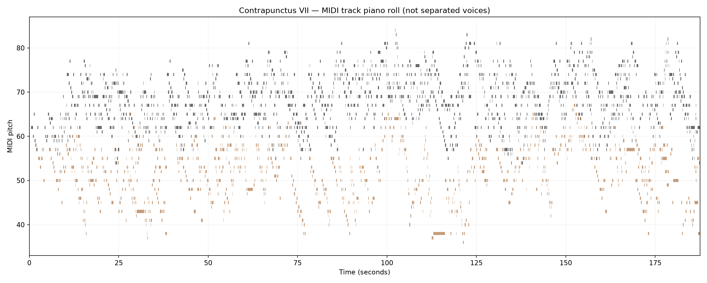

*Saved diagnostic render · Contrapunctus VII.*

Source: `code/v7/music_data.py`

```python
import pretty_midi

midi = pretty_midi.PrettyMIDI("kunst_der_fuge_08_(c)simonetto.mid")

print(len(midi.instruments))

for i, instrument in enumerate(midi.instruments):
    print("Voice", i + 1)
    print("Number of notes:", len(instrument.notes))
    print("Instrument:", instrument.name)

    notes = midi.instruments[0].notes

for note in notes[:5]:
    print(
        "Pitch:", note.pitch,
        "Start:", round(note.start, 2),
        "End:", round(note.end, 2)
    )
```

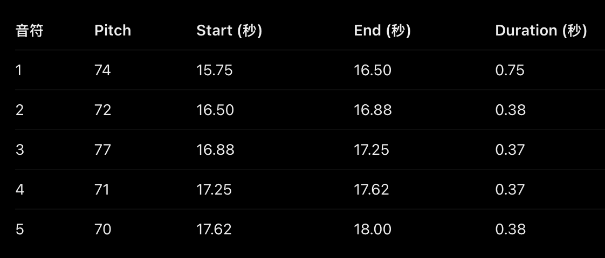

*Saved process screenshot · example note values.*

## 02 · Turning groups of notes into texture · V1

In the structured-fields sketch, I divided time into columns and pitch into bands. Each occupied cell becomes a patch of hatch marks. Pitch and intervals influence the hatch angle, the note count influences spacing, and average duration changes the patch size. The separate black SVG exports show that making one printable layer per voice was already part of the work at this point.

Source: `code/v1/fugue_structured_fields_v1.py`

```python
            t0 = START_SEC + (END_SEC-START_SEC)*c/COLS
            t1 = START_SEC + (END_SEC-START_SEC)*(c+1)/COLS
            bucket = [n for n in notes if t0 <= n.start < t1]
            if not bucket: continue
            # Subdivide into spatial pitch bands. These are artistic mappings,
            # not a literal score or an automatic fugue subject detector.
            for r in range(ROWS):
                band = [n for n in bucket if min(ROWS-1, max(0, int((n.pitch-36)/49*ROWS))) == ROWS-1-r]
                if not band: continue
                avg_pitch = sum(n.pitch for n in band)/len(band)
                avg_dur = sum(n.end-n.start for n in band)/len(band)
                pitches = [n.pitch for n in sorted(band, key=lambda n: n.start)]
                interval = sum(pitches[i]-pitches[i-1] for i in range(1,len(pitches))) / max(1,len(pitches)-1)
                density = len(band)
                # Shared vocabulary; voice-specific angles, spacing, displacement.
                angle = [22, -25, 65][v] + interval*2.4 + (avg_pitch-60)*0.55
                angle += 9*sin((c+1)*0.8 + r*0.45 + v)
                spacing = max(5.5, 12.5 - min(density, 12)*0.55 + v*0.5)
                cx = MARGIN+(c+0.5)*cell_w
                cy = MARGIN+(r+0.5)*cell_h
                # A subtle expansion depending on note duration; keeps cells separated.
                scale = min(0.94, 0.67 + avg_dur*0.18)
                ww, hh = cell_w*scale, cell_h*scale
                result[v].extend(hatch_cell(cx,cy,ww,hh,angle,spacing,v))
                # Extra crosshatching on denser note groups: a musical response.
                if density >= 5:
```

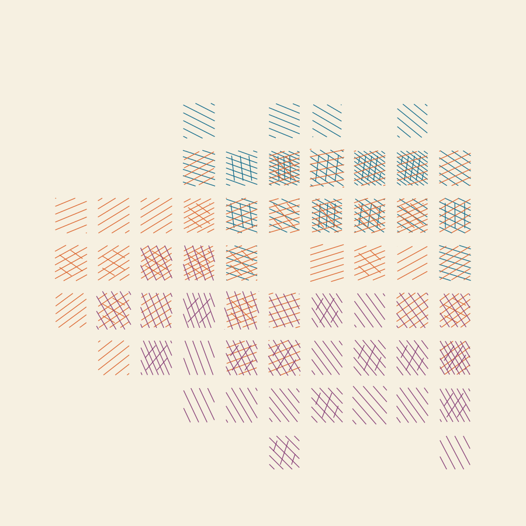

*Saved colour preview · hatched fields.*

## 03 · Following the melodic contour · V2–V3

V2’s saved images show two ways of reading the piece: stepped pitch traces and a paler drawing made of flowing vertical textures. I found the images in the V2 folder, with no matching Python script there. V3 is the nearby version with an identifiable code/export pair. Its horizontal position follows time, the vertical centre follows pitch, and the sketch samples interval, duration and local density to give the lines their shape and spacing.

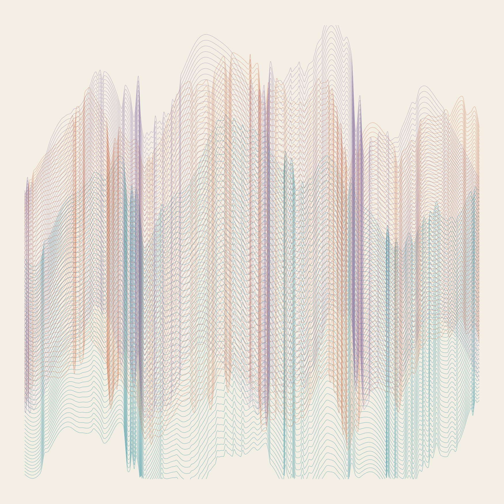

*Saved V2 render · flowing counterpoint. Matching source not located.*

Source: `code/v3/fugue_v3_py5canvas.py`

```python
def make_voice(v,notes):
    # All complexity responds to actual note events. No arbitrary sine wave frequency.
    # Each note contributes a local bowed line segment; repeated lines follow the same melody.
    samples=440
    lines=[]
    for k in range(samples):
        t=START_SEC+(END_SEC-START_SEC)*k/(samples-1)
        p=pitch_at(notes,t)
        interval=interval_at(notes,t)
        dur=duration_at(notes,t)
        density=density_at(notes,t)
        # Base position is EXACT MIDI pitch; small offsets make printing legible.
        center=y_for(p)
        # Note-controlled local undulation: one bend per note, not a free-running wave.
        current=[n for n in notes if n.start<=t]
        if current:
            n=current[-1]
            phase=min(1,max(0,(t-n.start)/max(.001,n.end-n.start)))
        else:phase=0
        bend=sin(pi*phase)*max(-12,min(12,interval*1.1))
        count=max(5,min(19,5+density*2))
        gap=1.45+min(2.1,dur*.65)
        lines.append((x_for(t),center+bend,count,gap,p,interval,dur,density))
```

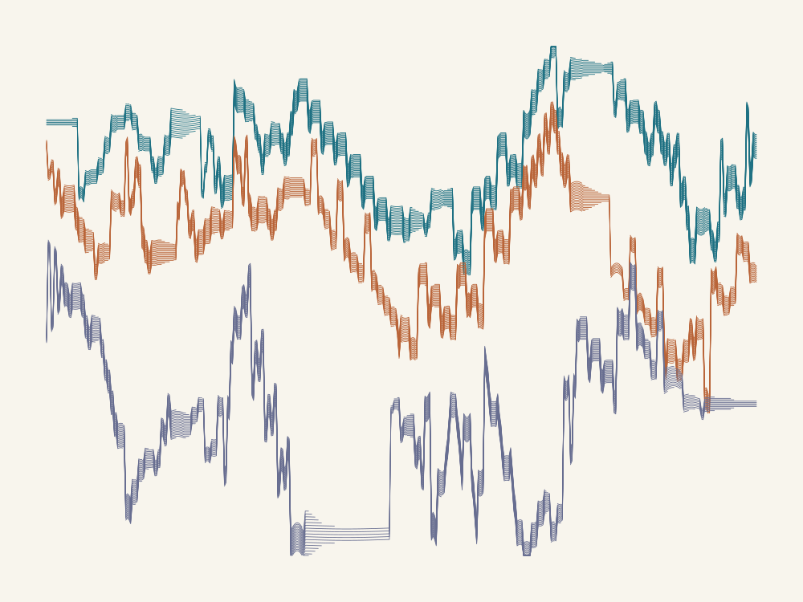

*Saved V3 combined SVG · pitch contours and nested strokes.*

## 04 · Making recurrence visible · V4

V4 tries a more selective rule. It searches across the three MIDI voices for the same sequence of seven pitch differences, an eight-note fingerprint. A matching passage supplies its pitch contour and rhythm to a shape on a shared circular field. This gave the project a way to show recurrence visually. The code calls it an interval fingerprint, so I would describe it as a recurring pattern rather than claiming to have identified every entry of a fugue subject. The re-render found 15 exact matches.

Source: `code/v4/fugue_v4_py5canvas.py`

```python
    raise ValueError(f'Expected 3 note-bearing MIDI tracks, found {len(voices)}')
TOTAL = pm.get_end_time()

# The exact eight-note interval fingerprint established in the earlier Motif Map.
# The motif is an interval pattern, NOT a verified complete fugue subject.
PATTERN = (-2, 5, -6, -1, -1, 5, -7)
N = len(PATTERN) + 1

# Each matching passage supplies a rhythmic fingerprint and melodic shape.
events = []
for v, notes in enumerate(voices):
    for i in range(len(notes) - N + 1):
        seq = notes[i:i + N]
        intervals = tuple(seq[j+1].pitch - seq[j].pitch for j in range(N-1))
        if intervals != PATTERN:
            continue
        onsets = [n.start for n in seq]
        gaps = [max(0.01, onsets[j+1]-onsets[j]) for j in range(N-1)]
        unit = sorted(gaps)[len(gaps)//2]
        rhythm = [g/unit for g in gaps]
        durations = [max(.01, n.end-n.start) for n in seq]
        events.append(dict(voice=v, start=seq[0].start, end=seq[-1].end,
                           pitches=[n.pitch for n in seq], rhythm=rhythm,
                           durations=durations, intervals=intervals))
```

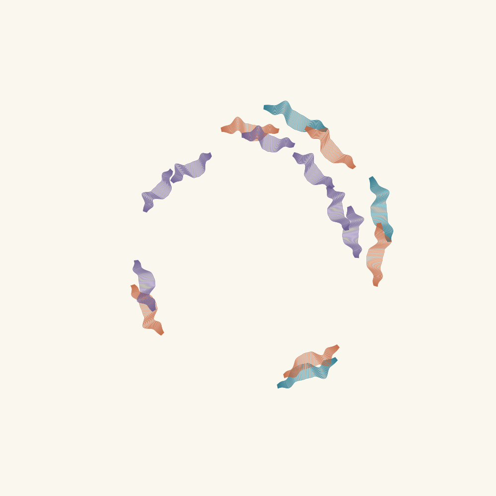

*V4 re-render · recurring interval pattern on a circular field.*

## 05 · Testing fields and threads · V5–V6

V5 returns to a shared grid. Each note has a position in time and pitch and bends the nearby lines. In V6 the grid gives way to straight threads between two moving endpoints. V6 takes the first 45 seconds, smooths pitch, interval and duration into a signal and draws 560 threads per voice. This is an important precursor to the fine-line look of V7. At this point the threads sample a smoothed signal rather than each standing for a single note.

Source: `code/v5/fugue_v5_grid_py5canvas.py`

```python
def influence(x, y, notes):
    displacement = 0
    for i, note in enumerate(notes):
        cx = MARGIN + (SIZE - 2 * MARGIN) * note.start / SECONDS
        cy = MARGIN + (SIZE - 2 * MARGIN) * (84 - note.pitch) / 50
        cy = max(MARGIN, min(SIZE - MARGIN, cy))
        interval = note.pitch - notes[i - 1].pitch if i else 0
        strength = max(-1, min(1, interval / 7))
        radius = RADIUS + 22 * min(1, note.end - note.start)
        d2 = ((x - cx) ** 2 + (y - cy) ** 2) / (radius ** 2)
        if d2 < 9:
            displacement += BEND * strength * math.exp(-d2 * 0.9)
    return BEND * math.tanh(displacement / BEND)
```

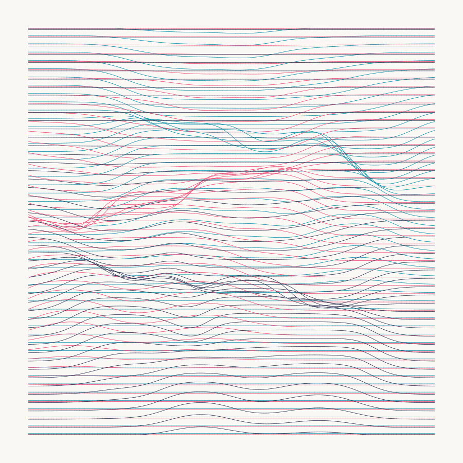

*V5 re-render · note-driven grid deformation.*

Source: `code/v6/bach_v6_three_voices/bach_v6_core.py`

```python
def segments(voice_id, notes):
    """Two smoothly moving endpoints, joined by hundreds of fine straight threads."""
    signal = music_curve(notes)
    output = []
    # All voices share the same centered composition; their motion differs by MIDI.
    # The three base offsets are design choices, not musical facts.
    offsets = (0.0, 0.75, 1.5)
    for i in range(THREADS):
        u = i / (THREADS - 1)
        j = min(STEPS - 1, int(u * (STEPS - 1)))
        pitch, interval, duration = signal[j]
        t = 2 * math.pi * (1.65 * u) + offsets[voice_id]
        # Real pitch changes orbit size; intervals alter the phase relation.
        # Duration modulates the secondary orbit. Smooth signals prevent kinks.
        r1 = 245 + 33 * math.tanh(pitch)
        r2 = 188 + 30 * duration
        a1 = t + 0.20 * interval
        a2 = 1.65 * t + 0.55 * interval + 0.40 * pitch
        x1 = 450 + r1 * math.cos(a1)
```

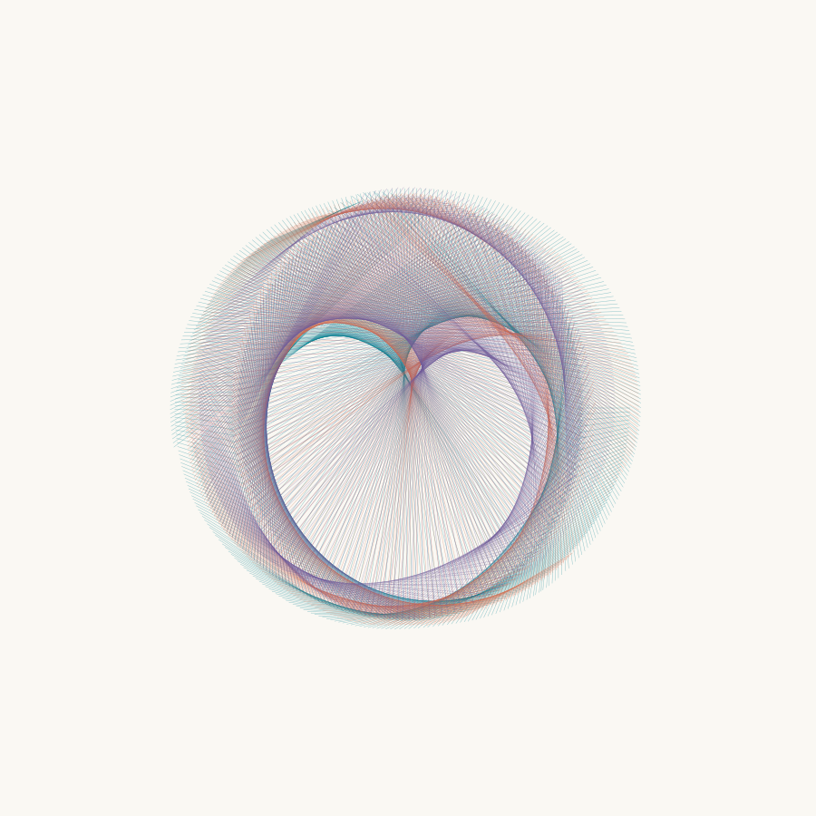

*Saved V6 combined SVG · three sets of fine threads.*

## 06 · Iterating on the circle · V7 tests 1–4

The first two saved V7 studies are useful as a pair. The first has a visibly uneven, web-like edge. The second brings the strokes into a tighter band. Their code screenshots are saved beside the corresponding renders, so these can go straight into a journal as evidence of iteration.

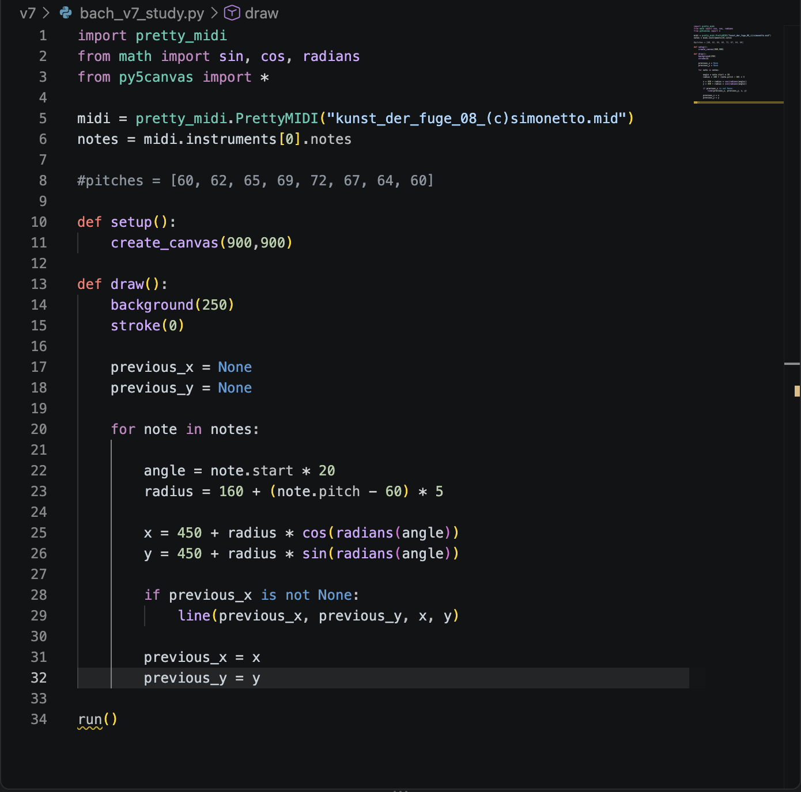

*V7 study 1 · saved code screenshot.*

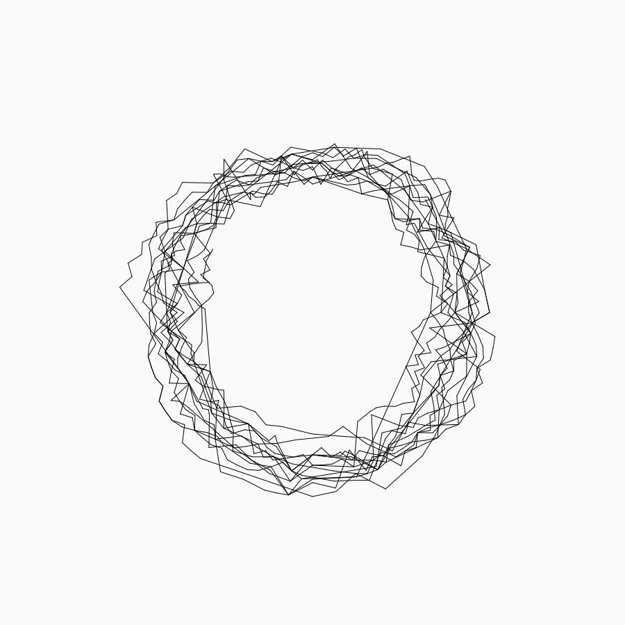

*V7 study 1 · saved render.*

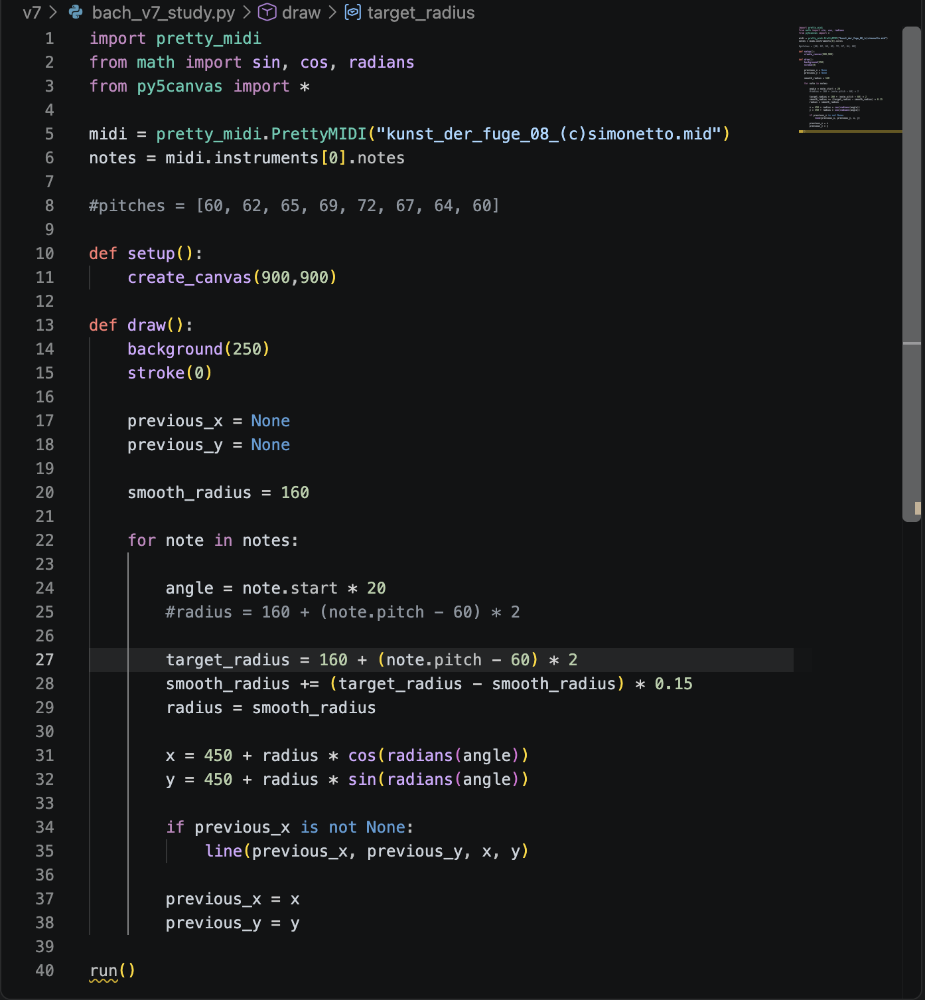

*V7 study 2 · saved code screenshot.*

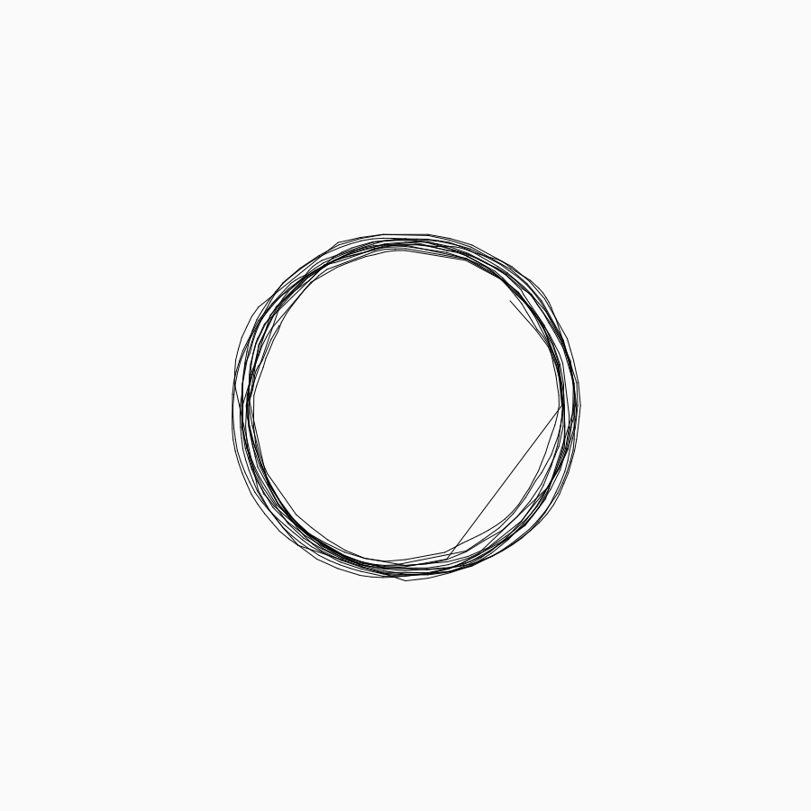

*V7 study 2 · saved render.*

Tests 3 and 4 both space notes by their list index. Test 3 uses two different radial oscillations and a fixed 15-degree offset between endpoints. Test 4 changes several things at once: it uses the current and next note’s pitch for the two radii, and makes the second angle larger and pitch-dependent. The resulting lines reach farther across the circle. Because the track changes too, the difference in appearance cannot be attributed to a single parameter.

Source: `process/v7 3/Untitled2.rtf`

```python

        amplitude = 45 + (note.pitch - 60) * 2

        radius1 = 180 + amplitude * sin(radians(angle * 6))
        radius2 = 180 + amplitude * cos(radians(angle * 10))

        x1 = 450 + radius1 * cos(radians(angle))
        y1 = 450 + radius1 * sin(radians(angle))

        angle2 = angle + 15
        x2 = 450 + radius2 * cos(radians(angle2))
        y2 = 450 + radius2 * sin(radians(angle2))

        line(x1, y1, x2, y2)
```

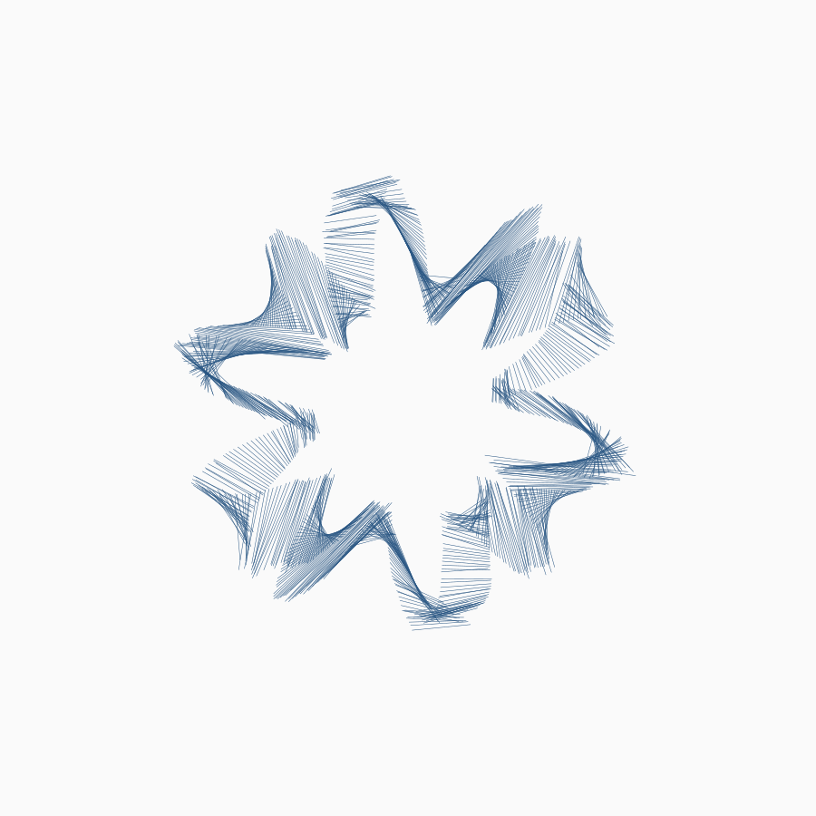

*V7 study 3 · saved output accompanying the RTF code.*

Source: `process/v7 4/Untitled.rtf`

```python

        amplitude = 45 + (note.pitch - 60) * 4

        radius1 = 180 + (note.pitch - 60) * 7
        radius2 = 180 + (notes[(i + 1) % len(notes)].pitch - 60) * 7

        x1 = 450 + radius1 * cos(radians(angle))
        y1 = 450 + radius1 * sin(radians(angle))

        angle2 = angle + 70 + (note.pitch - 60) * 3
        x2 = 450 + radius2 * cos(radians(angle2))
        y2 = 450 + radius2 * sin(radians(angle2))

        line(x1, y1, x2, y2)
```

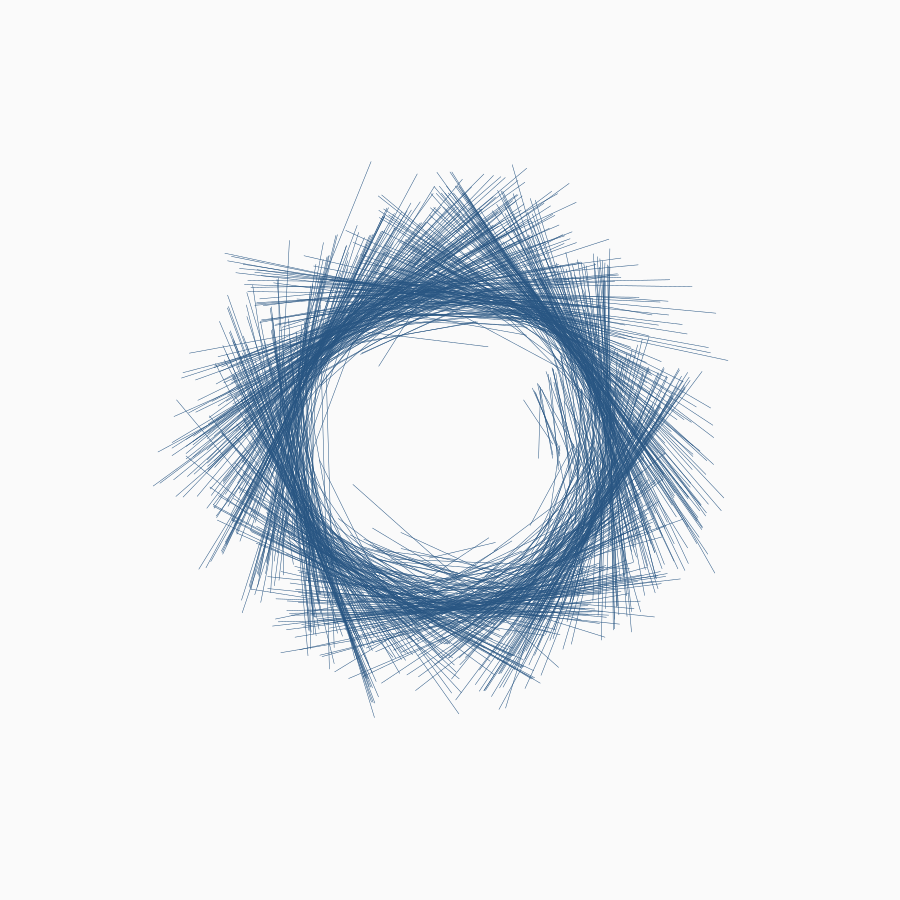

*V7 study 4 · saved output accompanying the RTF code.*

## 07 · One shared clock, three voices · V7 test 5 and current scripts

The decisive change was moving from note index to MIDI time. In the current desktop scripts, each note becomes a line. Its start and end set the two angles, the whole piece spans a clockwise turn starting at twelve o’clock, and pitch changes the strength of the radius modulation. The two trigonometric curves are design choices. Angular separation encodes duration, while the actual length of a line also depends on the difference between the radii. The shared clock lets the three sheets register at the same musical moment.

The three archived test-5 PNGs are all blue. They document the shapes of the separate voices. The desktop V7 scripts specify blue, orange-red and green, so these saved PNGs are not evidence of the three-colour print. The previously uploaded Voice 2 script also uses a base radius of 180, while the desktop Voice 2 script uses 300. Treat these as different snapshots when pairing code and output.

Source: `code/v7/bach_v7_voice_1.py`

```python

        # Start at twelve o'clock; time moves clockwise.
        angle = note.start / total_time * 360 - 90
        angle2 = note.end / total_time * 360 - 90

        amplitude = 45 + (note.pitch - 60) * 2

        radius1 = 300 + amplitude * sin(radians(angle * 6))
        radius2 = 300 + amplitude * cos(radians(angle * 10))

        x1 = 450 + radius1 * cos(radians(angle))
        y1 = 450 + radius1 * sin(radians(angle))

        x2 = 450 + radius2 * cos(radians(angle2))
        y2 = 450 + radius2 * sin(radians(angle2))

        line(x1, y1, x2, y2)
```

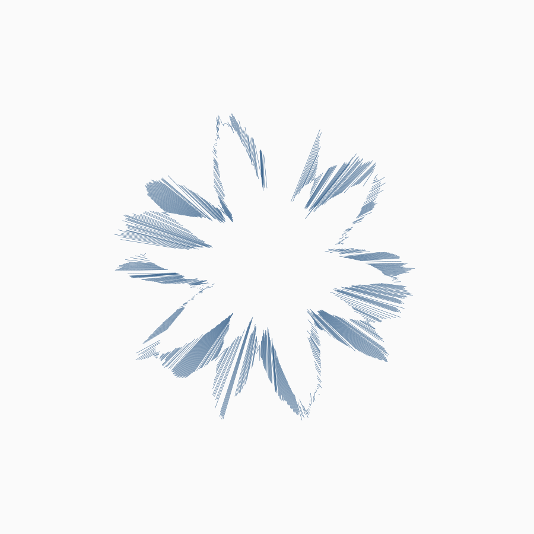

*V7 test 5 · saved blue study for voice 1.*

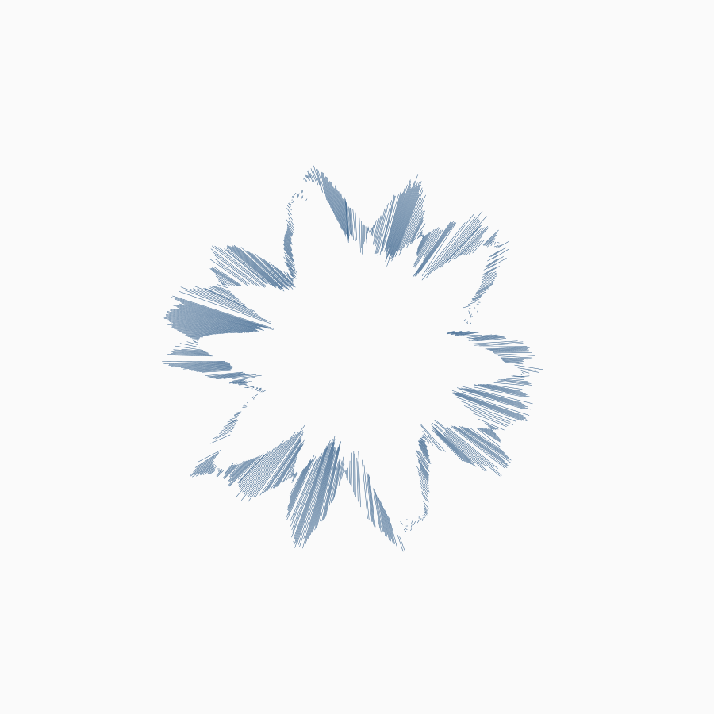

*V7 test 5 · saved blue study for voice 2.*

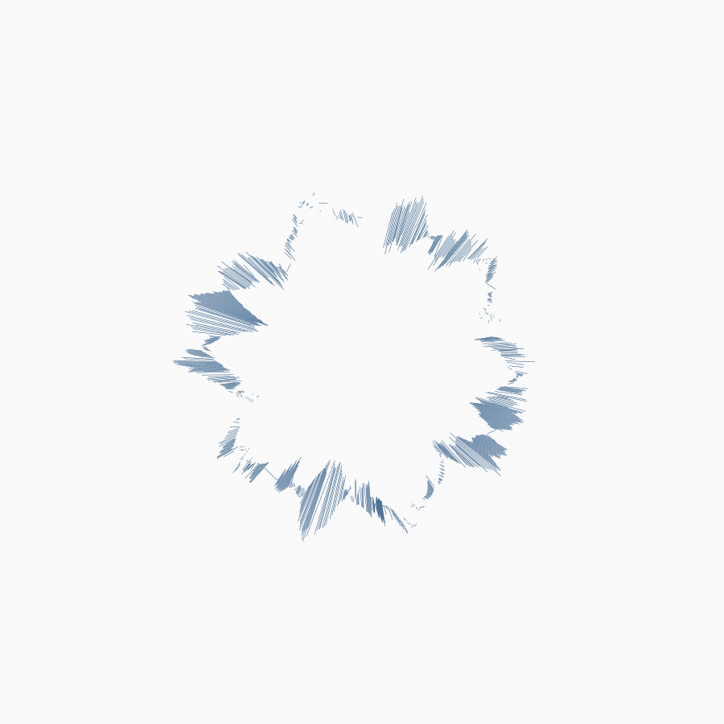

*V7 test 5 · saved blue study for voice 3.*

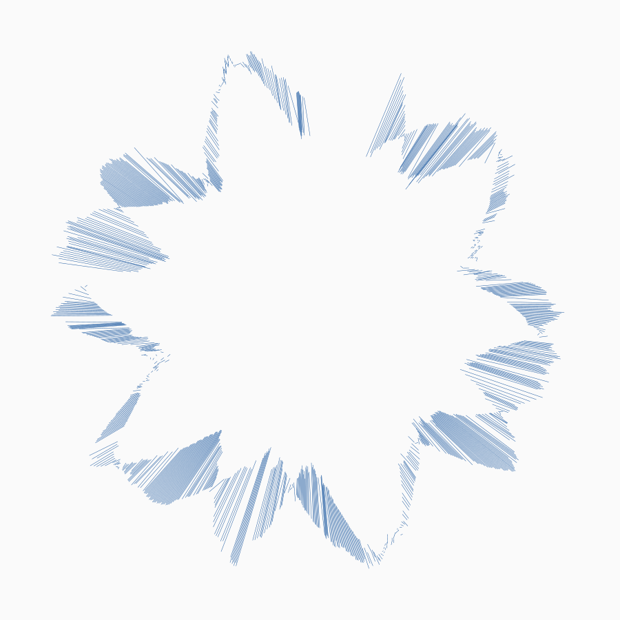

*Desktop V7 Voice 1 · fresh re-render from its own script and local MIDI.*

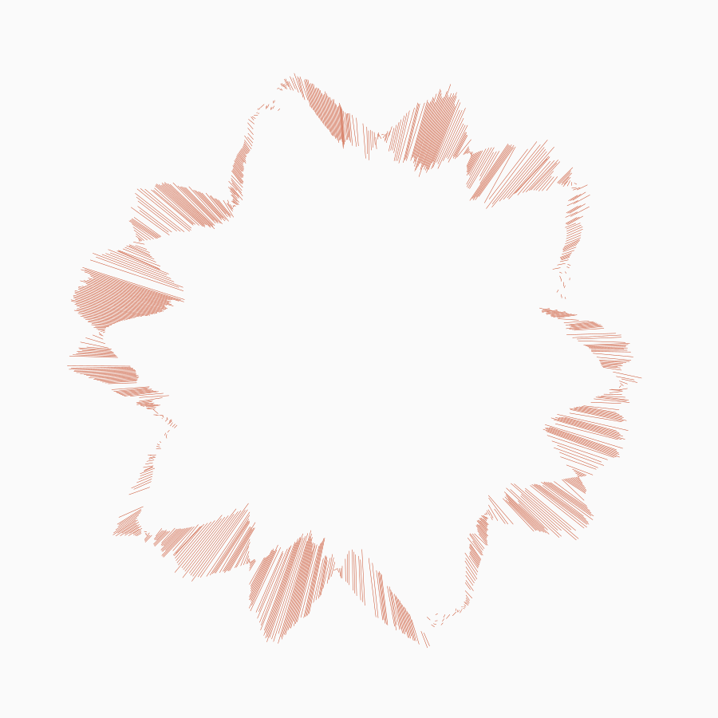

*Desktop V7 Voice 2 · fresh re-render from its own script and local MIDI.*

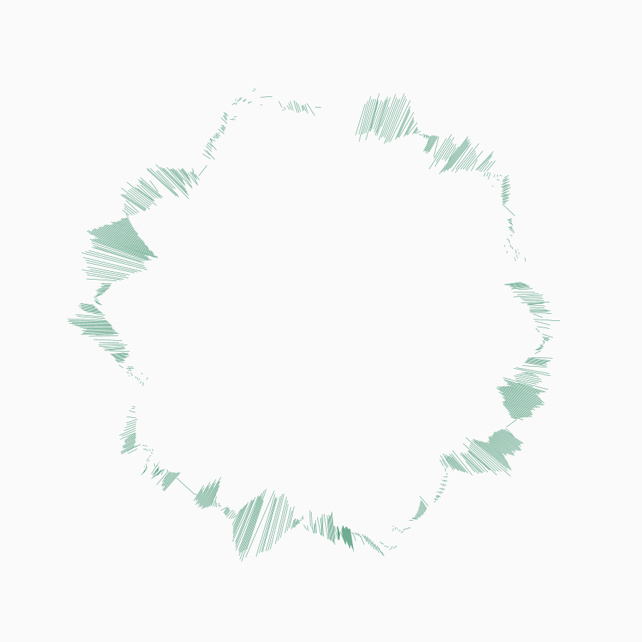

*Desktop V7 Voice 3 · fresh re-render from its own script and local MIDI.*

## 08 · A more literal radial comparison · V8 study

The folder also contains a study that gives each voice its own concentric band. Pitch moves a note inward or outward within its band, and the note is an arc from its onset to its end. This is a useful comparison with the selected layered direction. Concentric rings keep voices apart on one sheet, while the three-sheet version places the voices in the same visual space and lets the viewer change how they overlap.

Source: `code/v7/bach_v8_study.py`

```python
    for i, voice in enumerate(voices):
        base_radius = 100 + (i + 0.5) * band_width
        stroke(*colors[i % len(colors)])
        stroke_weight(1.6)

        for note in voice.notes:
            radius = base_radius + (note.pitch - pitch_center[i]) * pitch_scale
            start_angle = note.start / total_time * 2 * pi - pi / 2
            end_angle = note.end / total_time * 2 * pi - pi / 2

            # Short segments form an arc whose length records note duration.
            steps = max(1, ceil((end_angle - start_angle) * radius / 2))
            for step in range(steps):
                a = start_angle + (end_angle - start_angle) * step / steps
                b = start_angle + (end_angle - start_angle) * (step + 1) / steps
                line(450 + radius * cos(a), 450 + radius * sin(a),
```

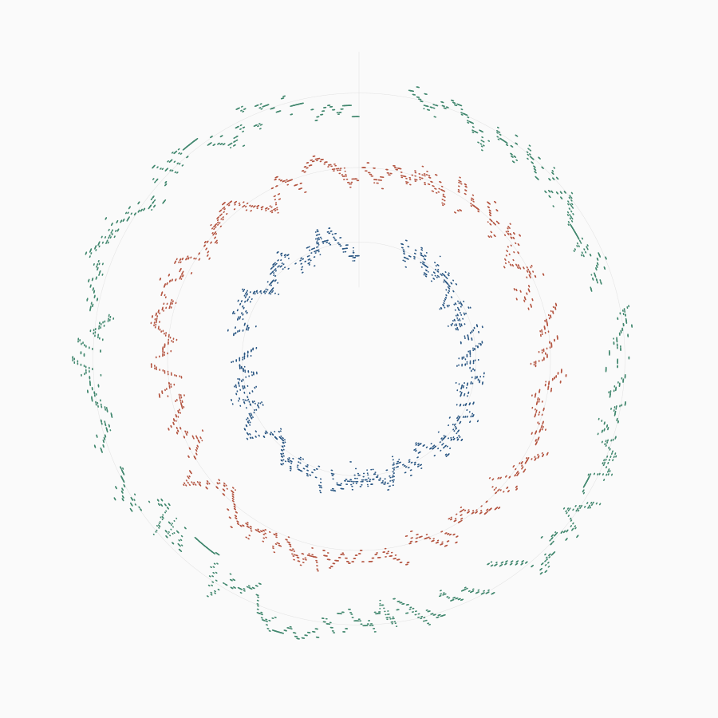

*V8 re-render · three concentric bands on one clock.*

## 09 · Translating the drawing into an object

I first considered screen printing because overlapping inks could create another colour. When the workshop option did not work out, I moved toward printing the voices on three separate sheets of translucent tracing paper. That kept the overlap physically changeable. The gallery references led to a freestanding frame that viewers could circle. The conversation then moved to a shallower wall-mounted version that fits the brief and suits A4 prints. We discussed reducing the visibility of the mount and keeping the sheets close, with the centres aligned and approximately 2 cm between adjacent layers as a starting point.

The hanging images below are AI-assisted design studies. They show mounting ideas, and the linework in them was approximated by the image generator. There is no verified photograph of a completed installation in this journal. The next entry should record an actual paper and spacing test, with one frontal and one oblique photo and a note on what stays readable.

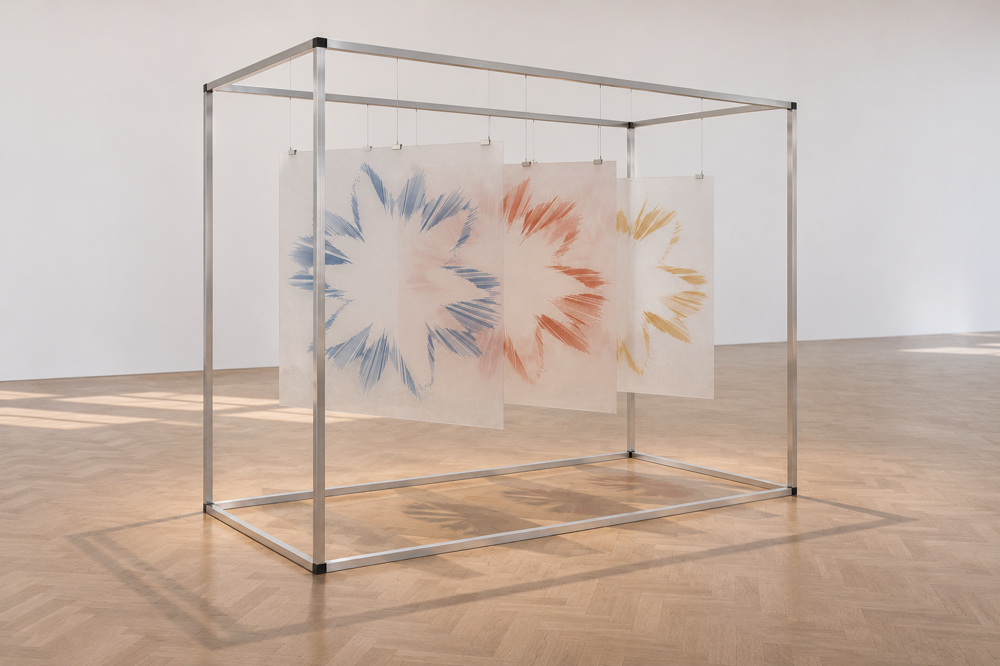

*AI concept mockup · freestanding frame.*

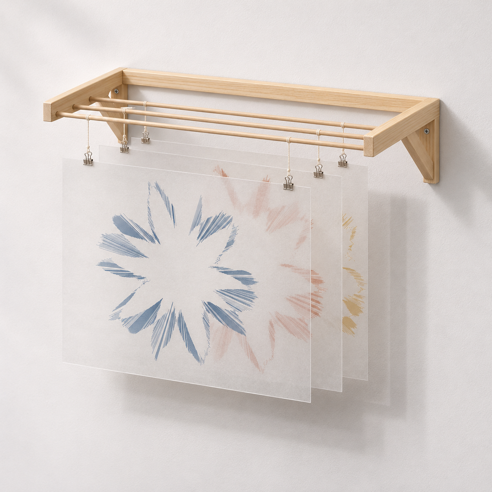

*AI concept mockup · shallow wall mount.*

## For the shorter assessment report

Three representative figures: **(1)** MIDI note data beside the piano roll, **(2)** a V7 code-and-render comparison showing the move toward the shared time mapping, **(3)** the real translucent-paper test. Keep the final installed photograph separate. Use the journal as the fuller version record.

**Credits to complete.** The code names the Mutopia and Simonetto MIDI files. Add the original download pages and any edition or licence information before sharing the source files. Record ChatGPT assistance with MIDI import, the mapping of MIDI fields into drawing variables, the display mockups and the organisation of this journal. Check the account of these contributions against what was actually used in the final work.
